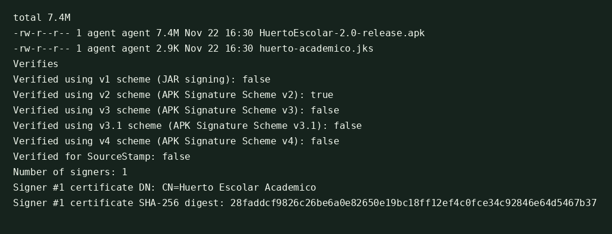

# Huerto escolar

Aplicación Android para el taller de un huerto escolar ficticio. El docente organiza los bancales, planifica el trabajo y revisa entregas. Cada estudiante ve sus actividades, entrega evidencias y reporta problemas. La base Room y los archivos de imagen residen en la instalación. El inventario y la agenda del taller se comparten a través de dos servicios Spring Boot. Para demostrar la colaboración entre roles se cambia de cuenta en el mismo teléfono o emulador.

## Ejecutar

1. Abrir en Android Studio la carpeta que contiene `settings.gradle.kts`.
2. Seleccionar un JDK 17 para Gradle e instalar Android SDK Platform 35 y Android SDK Build-Tools 34.0.0. La primera sincronización necesita conexión para obtener dependencias.
3. Seleccionar el módulo **app** y un teléfono o emulador Android 8.0 (API 26) o superior. Pulsar **Run**.
4. En terminal, `./gradlew testDebugUnitTest assembleDebug` ejecuta pruebas y genera `app/build/outputs/apk/debug/app-debug.apk`. En Windows usar `gradlew.bat`. Para instalar en un dispositivo conectado, ejecutar `./gradlew installDebug`.

## Cuentas ficticias

| Cuenta | Rol | Clave de demostración |
|---|---|---|
| docente | Administrador | Huerto123 |
| luna | Estudiante | Huerto123 |
| nico | Estudiante | Huerto123 |
| sol | Estudiante | Huerto123 |

La primera apertura crea el sector Bancal norte, un cultivo de acelga, trabajos con fechas relativas al día de instalación, un problema, una entrega pendiente de revisión y dos lecturas simuladas. Reiniciar mantiene los cambios. Borrar los datos de la aplicación reinicia la demostración y elimina lo guardado.

## Probar el flujo principal

1. Entrar como **luna**, abrir **Mis tareas**, iniciar **Riego**, agregar comentario y elegir o tomar una foto. Entregar.
2. Salir y entrar como **docente**. Abrir **Revisar entregas**, seleccionar Riego y rechazarla con un motivo.
3. Volver como **luna**, leer el comentario, corregir y entregar otra fotografía.
4. Aprobar como **docente**. Revisar las dos entregas desde el historial. Reiniciar la aplicación y abrir nuevamente el detalle.
5. En **Problemas del huerto**, registrar un problema y actualizar su atención como docente. Consultar **Avisos** y **Sensores simulados**.

## Tecnologías y organización

Kotlin, Jetpack Compose, Material Design 3, Navigation Compose, Room sobre SQLite, Kotlin Coroutines, Flow, StateFlow, ViewModel, Photo Picker, TakePicture, FileProvider, Coil, JUnit y Robolectric. El repositorio contiene un módulo Android dividido en paquetes de presentación, dominio y datos. La gestión de tareas funciona localmente. El inventario y la agenda usan los servicios propios, y el tiempo meteorológico se consulta a Open-Meteo. Las instrucciones, recorridos de evaluación y explicación del modelo están en [la guía técnica y de defensa](docs/Guia-de-defensa.md).

## Equipo y evidencias de colaboración

Titular de los repositorios indicados: **struqueuzi**. Completar los nombres oficiales de ambos integrantes y el enlace al tablero de planificación antes de la entrega. Los créditos individuales deben reflejar los aportes reales. El historial de esta rama identifica los cambios técnicos del desarrollo asistido.

## Experiencia 3 · EP4 y EP5

Esta rama agrega inventario y agenda con Spring Boot, CRUD desde Android y clima de San Bernardo mediante Retrofit. Para conexión, pruebas, firma y defensa consulta [la guía de EP4 y EP5](docs/EP4-EP5.md). Endpoints propios: /api/insumos (8081) y /api/jornadas (8082), con GET/POST en la colección y GET/PUT/DELETE por ID. API externa: https://api.open-meteo.com/v1/forecast con latitude, longitude, current y timezone. El proyecto backend contiene dos aplicaciones ejecutables independientes. Para instalar el release usa el APK correspondiente a la rama desarrollo-ep4.

### Archivos firmados

La carpeta entrega contiene HuertoEscolar-2.0-release.apk y el almacén académico huerto-academico.jks cifrado. La contraseña se entrega al titular por separado. El APK usa el esquema v2 y un certificado con nombre Huerto Escolar Academico. Ver la salida de apksigner en docs/verificacion/firma-apk.txt.

### Integración del rediseño y las pruebas de ramas

El código de esta rama incluye el acceso fotográfico y la navegación de Huerto · Cosecha. Para probar esa interfaz en Android, descarga la [APK del rediseño](https://github.com/struqueuzi/huertoescolar-frontend/releases/download/vista-bfedb78e/Huerto-Visual.apk). El APK académico firmado en entrega corresponde a la versión 2.0 anterior al rediseño.

La [medición del 23 de noviembre](https://github.com/struqueuzi/huertoescolar-frontend/actions/runs/45181185359) registró 248 de 282 ramas (87,94 %) y 223 de 229 líneas (97,38 %) en la lógica seleccionada. El flujo de cobertura publica el informe de cada ejecución como artefacto.
